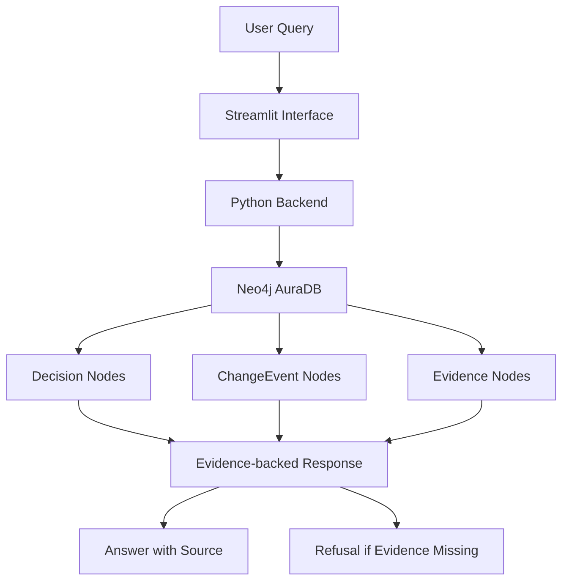

# Why The Code Is Like This

### Evidence-backed Code Decision Explainer

Understand why code changes happened, when they happened, and what evidence supports those decisions.

## Problem

Developers frequently encounter deprecated or removed functions in existing codebases. However, understanding why a function was deprecated or removed often requires searching through old issues, pull requests, changelogs, and discussions.

This makes historical code decisions difficult to understand and verify.

## Solution

**Why The Code Is Like This** is an evidence-backed code decision explainer that retrieves historical decisions from Neo4j and presents:

- Current status of a code entity.
- Original rationale supported by a source quote.
- Deprecation and removal versions.
- Original GitHub issue or pull request.
- Historical change timeline.

The system avoids generating unsupported explanations. If it cannot find a matching verified decision, it returns a refusal instead.

## Architecture



## Tech Stack

| Technology | Purpose |
|---|---|
| Python | Application logic |
| Streamlit | User interface |
| Neo4j AuraDB | Decision and evidence graph |
| Cypher | Graph queries |
| GitHub | Historical source evidence |
| Requests | HTTPS API communication |
| python-dotenv | Environment configuration |

## How It Works

1. User enters a function or code entity.
2. Python backend searches matching entities in Neo4j.
3. The application retrieves associated change events and evidence.
4. It displays the rationale, source link, and version history.
5. If no matching verified decision exists, the application refuses to invent an explanation.

## Current Dataset

The current prototype covers three manually curated Flask decisions.

| Entity | Deprecated | Removed |
|---|---|---|
| `app.before_first_request` | Flask 2.2.0 | Flask 2.3.0 |
| `got_first_request` | Flask 2.3.0 | Flask 3.0.0 |
| `test_client.as_tuple` | Flask 2.0.3 | Flask 2.1.0 |

## Evidence Verification

The rationale quotes are manually curated from original GitHub discussions and pull requests.

A Python verification script (`verify_quotes.py`) checks whether the stored quotes match the fetched source data.

The system links answers to their original GitHub evidence rather than presenting unsupported generated explanations.

**Important distinction:** The `got_first_request` explanation is a housekeeping note from PR #4997: the property was missed during the earlier deprecation of `before_first_request`. It is not a deeper design rationale.

## Refusal Mechanism

The system follows an evidence-first approach.

When a user asks about an unsupported entity or a decision without matching evidence, the application returns a refusal instead of generating a potentially misleading explanation.

## Evaluation

The prototype was manually tested using known Flask entities, aliases, and unsupported queries.

Evaluation categories include:

- Known entity queries.
- Entity alias queries.
- Unknown function queries.
- Unsupported framework queries.
- Missing evidence queries.

Quantitative accuracy is not claimed because a complete independently measured benchmark has not been established.

## Limitations

- Current coverage is limited to three Flask decisions.
- Decisions are manually curated.
- LLM-based decision extraction is not implemented.
- The current prototype does not perform large-scale automatic supersession detection.
- Evaluation is currently based on a small manually tested query set.

## Future Roadmap

- Expand coverage to more repositories.
- Introduce LLM-assisted decision extraction.
- Implement supersession detection at scale.
- Support more programming languages and frameworks.
- Develop a VS Code extension.

## Project Structure

```text
WhyTheCodeIsLikeThis/
│
├── app.py
├── decisions.json
├── fetch_cases.py
├── verify_quotes.py
├── load_neo4j.py
├── test_connection.py
├── test_https.py
├── check_tls.py
├── data/
├── .env
└── README.md
```

The `.env`, virtual environment, and cloned Flask source repository are excluded from version control.

## Setup Instructions

### 1. Clone the repository

```bash
git clone https://github.com/ikhushichauhan/WhyTheCodeIsLikeThis.git
cd WhyTheCodeIsLikeThis
```

### 2. Create a virtual environment

```bash
python -m venv venv
```

Activate on Windows:

```powershell
.\venv\Scripts\Activate.ps1
```

### 3. Install dependencies

```bash
pip install streamlit requests python-dotenv neo4j
```

### 4. Configure Neo4j

Create a `.env` file in the project root with your own Neo4j AuraDB credentials:

```env
NEO4J_HTTP_URL=your_neo4j_https_endpoint
NEO4J_USERNAME=your_username
NEO4J_PASSWORD=your_password
NEO4J_DATABASE=your_database_name
```

Never commit `.env` or share your credentials.

### 5. Load decisions into Neo4j

```bash
python load_neo4j.py
```

### 6. Launch the application

```bash
streamlit run app.py
```

## Screenshots

Add the following screenshots:

1. Application response for `before_first_request`.
2. Application response for `test_client.as_tuple`.
3. Evidence link and change history.
4. Neo4j graph visualization.

---

**Project:** Why The Code Is Like This  
**Category:** AI and Developer Tools  
**Track:** Neo4j
